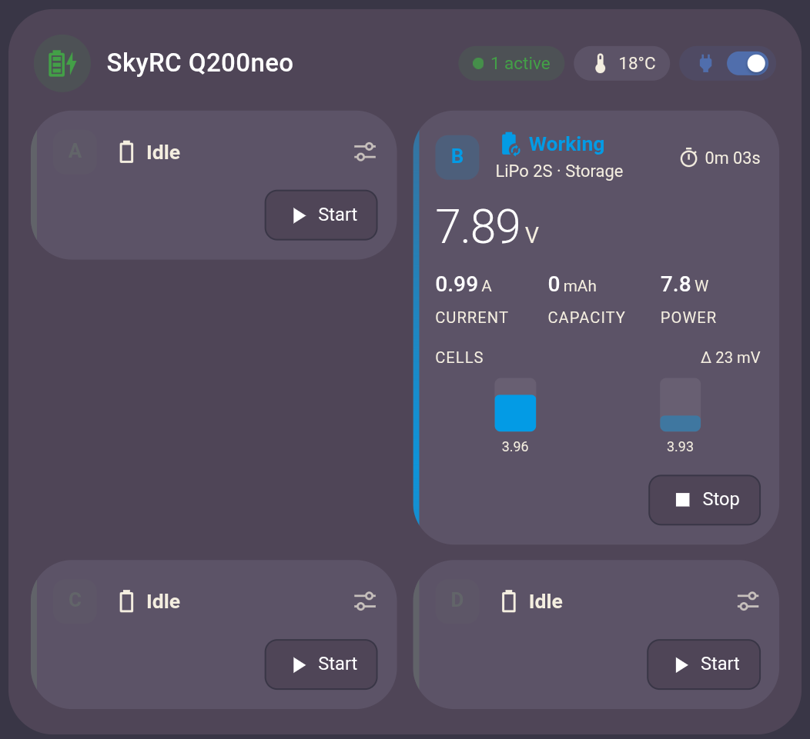
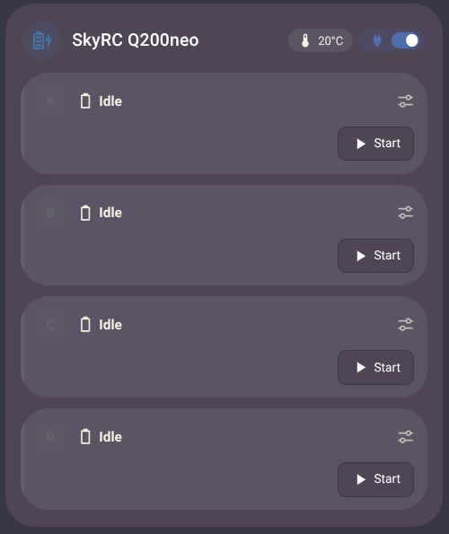
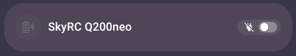
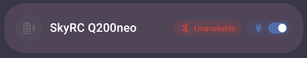
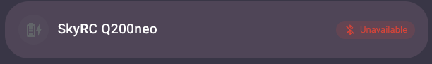

# SkyRC Charger Card

[](https://github.com/sargeantpepper/SkyRCchargercard/actions/workflows/validate.yml) [](https://hacs.xyz)

A custom Home Assistant dashboard card for SkyRC Bluetooth battery chargers (Q200neo and other neo-series models), built on the [ha-skyrc](https://github.com/lightheaded/ha-skyrc) integration.



## Features

- **Every channel at a glance**: status colour-coded (charging, discharging, done, error, idle) with a moving edge while it's working, plus battery type, cell count and program.
- **Live values**: pack voltage, current, capacity, pack temperature (or power when there's no probe) and elapsed time.
- **Cell balance**: a bar for each cell's voltage, with the spread between highest and lowest cell flagged in red past a threshold.
- **Controls**: Start and Stop per channel (Stop needs a second tap within 3 seconds), and a preset picker.
- **Set-up popup**: tap a channel that isn't running to choose battery type, program and settings, save presets and start it.
- **Header**: an icon, active-channel count with their total power, the charger's internal temperature and an optional switch (e.g. the smart plug powering the charger).
- **Collapses** to its header row when the charger is unavailable or the switch is off.
- Follows your theme in light and dark mode, with a visual editor.

## Screenshots

**Idle**: channels that aren't running shrink to a single row. Tap one to set up its program.



**Collapsed**: with the header switch off (here, the plug feeding the charger), the card shrinks to its header row so you can turn it back on.



**Unavailable**: with the switch on but the charger not responding over Bluetooth, a red *Unavailable* chip shows something is wrong.



Without a header switch, the card does the same whenever the charger is unavailable.



## Requirements

- Home Assistant 2024.12 or newer
- The [ha-skyrc](https://github.com/lightheaded/ha-skyrc) integration, set up with your charger. The set-up popup and presets need its **0.4.0** release or later (currently a beta: in HACS, turn on *Show beta versions* for SkyRC Charger).

## Installation

### HACS (recommended)

1. HACS → ⋮ → **Custom repositories**
2. Add `https://github.com/sargeantpepper/SkyRCchargercard`, category **Dashboard**
3. Find **SkyRC Charger Card** in HACS and download it
4. Reload your browser

HACS adds the dashboard resource for you and refreshes it on every update.

### Manual

1. Download `skyrc-card.js` from the [latest release](https://github.com/sargeantpepper/SkyRCchargercard/releases/latest) and copy it to `/config/www/SkyRC-ChargerCard/skyrc-card.js`.
2. **Settings → Dashboards → ⋮ → Resources → Add resource**
   URL: `/local/SkyRC-ChargerCard/skyrc-card.js?v=1.6.1`, type **JavaScript module**.
3. Reload your browser.

When you update a manual install, change the `?v=` number on the resource to the new version so browsers fetch the new file instead of a cached one. The version you're running is printed in the browser console as `SKYRC-CARD 1.6.1`.

## Usage

Add **SkyRC Charger** from the card picker, or in YAML:

```yaml
type: custom:skyrc-card
```

With no options it finds the first SkyRC charger on its own. A fuller example:

```yaml
type: custom:skyrc-card
title: Battery charger
icon: mdi:car-battery
switch_entity: switch.charger_plug
switch_name: Power
channels: [A, B]
```

## Options

| Option | Default | Description |
| --- | --- | --- |
| `device` | first SkyRC device | Device ID of the charger (pick it in the visual editor). |
| `title` | device name | Card title. Set to `""` to hide the header. |
| `icon` | `mdi:battery-charging-high` | Icon beside the title. It turns green while a channel is running and grey when the charger is unavailable. Set to `""` to hide it. |
| `channels` | `[A, B, C, D]` | Which channels to show, e.g. `[A, B]`. |
| `show_cells` | `true` | Per-cell voltage bars. |
| `show_controls` | `true` | Start / Stop buttons and the preset picker. |
| `compact_idle` | `true` | Collapse idle / offline channels to one row. |
| `stage_popup` | `true` | Tap a channel that isn't running to open a popup for setting up its program. |
| `collapse_offline` | `true` | When the charger is unavailable, collapse the card to its header row. It expands again when the charger reconnects. A red *Unavailable* chip shows in the header while the charger isn't responding, unless the header switch is off (then the charger is simply turned off). |
| `cell_warning_mv` | `50` | Cell spread (mV) at which Δ turns red. |
| `switch_entity` | — | Optional switch shown as a toggle in the header, next to the temperature (e.g. the smart plug powering the charger). Must be a `switch` or `input_boolean` entity. While it is off, the card collapses to its header row so you can turn it back on. |
| `switch_name` | — | Label beside the toggle. Leave out for icon only. |
| `switch_icon` | entity's icon, else a plug | Icon for the toggle. |
| `prefix` | — | Fallback: build entity IDs from a slug like `charger_8f12` instead of using the entity registry. |

Entities are found through the entity registry, so renamed entity IDs keep working. Use `prefix` only if discovery doesn't find your charger.

## Setting up a channel

Tap a channel that isn't running (idle, done, ready) to open its set-up popup. Running channels open the usual more-info dialogs instead. The popup holds:

- **Preset**: apply a saved preset, or delete the selected one.
- **Battery type** and **Program**, then only the settings that program uses (cells, charge / discharge current, voltage per cell, and for NiMH / NiCd the peak sensitivity, cycle order and cycle count). Ranges come from the integration, and values are rounded to the nearest step it accepts.
- **Save as preset**: name the current settings and save them.
- **Start**: start the channel with these settings and close the popup.

Changes are applied as you make them, so Close keeps them and Start uses them later too.

*Peak sensitivity*, *cycle order* and *cycle count* are disabled by default in the integration; enable them on the charger's device page if you charge NiMH / NiCd packs.

## Notification when a channel finishes

The repo includes a blueprint that sends a notification to your phone when a channel finishes, for example:

> **🔋 Channel B charged**\
> LiPo 4S · 16.80 V · 1432 mAh\
> Cells 4.198–4.203 V (Δ5 mV)

[](https://my.home-assistant.io/redirect/blueprint_import/?blueprint_url=https%3A%2F%2Fgithub.com%2Fsargeantpepper%2FSkyRCchargercard%2Fblob%2Fmain%2Fblueprints%2Fautomation%2Fskyrc-channel-done.yaml)

1. Click the button above (or in Home Assistant go to **Settings → Automations & scenes → Blueprints → Import blueprint** and paste `https://github.com/sargeantpepper/SkyRCchargercard/blob/main/blueprints/automation/skyrc-channel-done.yaml`).
2. Click **Create automation** on the imported blueprint.
3. Pick the charger's channel status sensors, your phone, and the cell imbalance level that adds a ⚠️ (default 50 mV).

It says what finished (charged, discharged, at storage voltage, …), the battery type and cell count, voltage, capacity, cell spread and pack temperature, leaving out whatever the charger doesn't report. Voltage, capacity and temperature are found from the status sensor's entity ID, so they're left out if you've renamed those entities. Your phone needs the Home Assistant companion app.

## Notes

- **Start** runs whatever program is staged for the channel (the battery type / program / current entities on the device page, or the preset you pick in the card).
- The preset picker only appears once you've saved at least one preset.
- **Duration** is disabled by default in the integration; enable *Channel X duration* on the device page to see elapsed time in the card.
- Pack temperature only shows when an external probe is attached; otherwise that slot shows power (V × A).
- Colours follow your theme (`--success-color`, `--warning-color`, `--error-color`, …). Override them per card with card-mod using `--skyrc-charge`, `--skyrc-discharge`, `--skyrc-done`, `--skyrc-error`.

## Credits

- The [ha-skyrc](https://github.com/lightheaded/ha-skyrc) integration by lightheaded, which does all the talking to the charger.
- Written with [Claude](https://www.anthropic.com/claude). Review it before trusting it near your batteries.

Not affiliated with or endorsed by SkyRC.

## License

[MIT](LICENSE)
